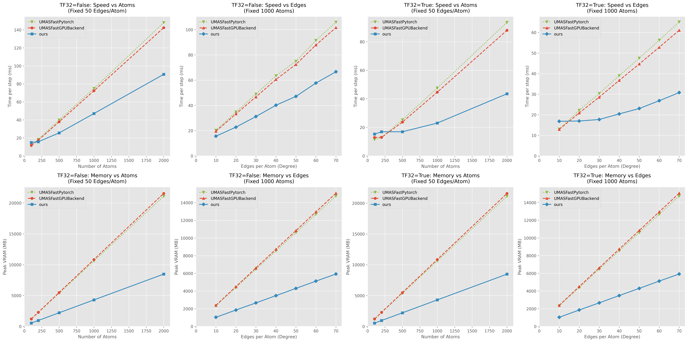

<h1 align="center">
  Triton-Accelerated ZeroAlloc Backbone for FAIRChem
</h1>

<h4 align="center">


[](https://opensource.org/licenses/MIT)

</h4>

This repository provides an unofficial, optimized inference engine for Meta FAIR's Universal Machine learning potential for Atomistic simulations ([UMA](https://huggingface.co/facebook/UMA)) and eSCN models. 

It provides a drop-in replacement backbone (`ZeroAllocBackbone`) that replaces default PyTorch operations with custom OpenAI Triton kernels. This implementation reduces inference execution time and peak VRAM consumption while maintaining numerical precision.

## Key Features

* **Memory Strategy**: Intermediate activations are computed in SRAM registers rather than materialized to High Bandwidth Memory (HBM). This reduces peak memory allocation.
* **Fused Triton Kernels**: 
  * Analytical Geometry & Wigner Matrix precomputation.
  * Fused LayerNorm + SiLU optimized for inference.
  * RotateScatter with FP64 accumulation to reduce variance during Molecular Dynamics (MD) reductions.
  * Pointwise Split Gating.
* **Graph Preprocessing**: Implements CSR caching and bypasses Python-level Morton sorting overheads during inference.
* **PyTorch Compilation**: Compatible with `torch.compile` using the `dynamic=True` flag.

## Benchmarks

Evaluated using `uma-s-1p2`, TF32 Enabled/not, and `torch.compile(dynamic=True)`.



### Scaling by Number of Atoms (Fixed Degree ~50)

| Atoms | Official GPU Time (ms) | Custom Time (ms) | Official GPU VRAM (MB) | Custom VRAM (MB) |
|:---:|:---:|:---:|:---:|:---:|
| 500 | 23.72 | 16.92 | 5,486 | 2,201 |
| 1000 | 44.67 | 23.00 | 10,842 | 4,295 |
| 2000 | 87.97 | 43.51 | 21,566 | 8,477 |

### Scaling by Graph Density (Fixed 1000 Atoms)

| Edges/Atom | Official GPU Time (ms) | Custom Time (ms) | Official GPU VRAM (MB) | Custom VRAM (MB) |
|:---:|:---:|:---:|:---:|:---:|
| 30 | 28.57 | 17.70 | 6,616 | 2,660 |
| 50 | 44.68 | 23.04 | 10,842 | 4,295 |
| 70 | 61.06 | 30.78 | 15,059 | 5,923 |

This memory reduction allows for larger system sizes or increased cutoff radii within standard VRAM limits.

## Installation

This repository requires a CUDA-capable GPU, PyTorch, and Triton. The official `fairchem-core` library is required to load the UMA model weights.

```bash
# 1. Install fairchem-core
pip install fairchem-core

# 2. Install latest Triton
pip install triton>=2.1.0

# 3. Clone this repository
git clone https://github.com/JabekAceus/FlashUMA.git
cd fast-uma-triton
```

Usage


The custom backbone can be applied to an existing FAIRChem predictor unit by
replacing the backbone attribute.

```bash

import torch
from fairchem.core.units.mlip_unit import load_predict_unit
from fairchem.core.units.mlip_unit.api.inference import InferenceSettings
from wrapper import ZeroAllocBackbone

# 1. Load the official UMA model
settings = InferenceSettings(
    execution_mode="umas_fast_gpu", This repository requires a CUDA-capable GPU, PyTorch, and Triton. The official fairchem-core library is required to load the UMA model weights.


    merge_mole=True, 
    external_graph_gen=True, 
    use_quaternion_wigner=True
)
predict_unit = load_predict_unit(path="uma-s-1p2.pt", inference_settings=settings, device="cuda")
model = predict_unit.model.module if hasattr(predict_unit.model, "module") else predict_unit.model

# Force stress and forces tracking 
model.backbone.regress_config.stress = True
model.backbone.regress_config.forces = True

# 2. Swap the backbone with ZeroAllocBackbone
model.backbone = ZeroAllocBackbone(model.backbone, dtype=torch.float32)
model = model.eval().cuda()

# 3. Compile (Recommended)
model = torch.compile(model, dynamic=True)

# 4. Run Inference
out = model(atomic_data_batch)
```

Implementation Details

The implementation uses custom Triton kernels to load raw edge data, compute
expansions (e.g., 34 Wigner-D polynomials and radial basis functions), and
scatter results without writing intermediate tensors to HBM.

1.  CSR Topology Caching: Sparse CSR formats (row_ptr, col_idx) are cached
    across steps to reduce topology evaluation overhead.
2.  Mixed-Precision Accumulation: M-to-L rotations upcast to FP64 within SRAM
    registers during accumulation. This limits floating-point reduction errors
    without the memory cost of using global FP64 variables.
3.  Overhead Reduction: Bypasses CPU-bound loops in the original Wigner
    Axis-Angle computation and Morton code sorting.

Acknowledgements

  - Meta FAIR Chemistry Team for the UMA/eSCN architecture and pre-trained
    weights.
  - OpenAI Triton for the GPU programming framework.

License

Available under the MIT License. The base UMA model weights maintain their
original licenses as defined by the FAIRChem repository.


