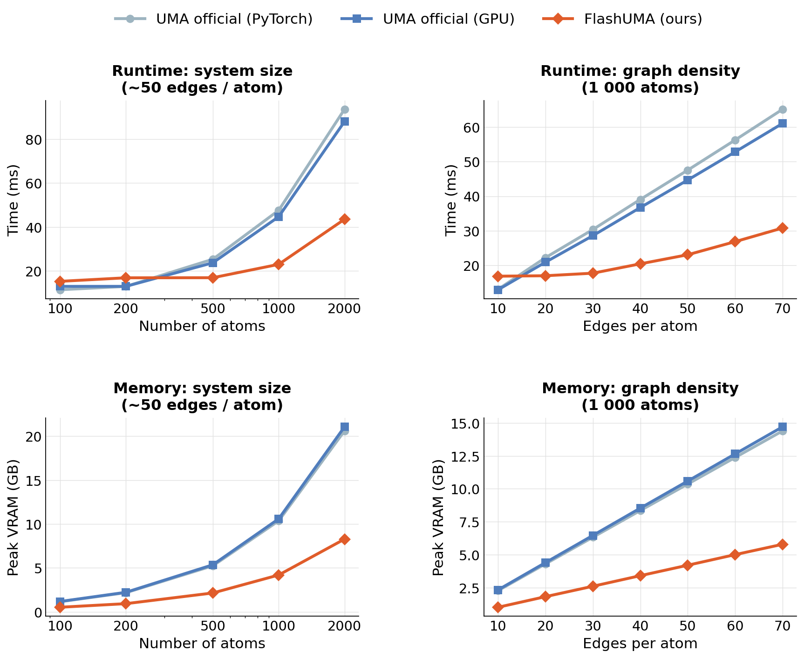

# FlashUMA

Fast inference for [UMA](https://huggingface.co/facebook/UMA) and eSCN models. Drop-in backbone replacement that executes custom Triton kernels and avoids materializing intermediate tensors to HBM — up to **2× faster** and **2.5× less peak VRAM** versus the FAIRChem GPU backend, with numerically equivalent outputs.

[](https://www.python.org/)
[](https://pytorch.org/)
[](https://github.com/openai/triton)
[](https://opensource.org/licenses/MIT)



*`uma-s-1p2` · TF32 enabled · `torch.compile(dynamic=True)`*

## Installation

Requires a CUDA GPU, PyTorch ≥ 2.0, Triton ≥ 2.1, and `fairchem-core`.

```bash
pip install fairchem-core triton>=2.1.0
git clone https://github.com/JabekAceus/FlashUMA.git
cd FlashUMA
```

## Usage

`ZeroAllocBackbone` wraps an existing FAIRChem backbone and requires no changes to the surrounding model. It is **inference only**: constructing the wrapper repacks and deletes the original parameters and sets `requires_grad=False`, so the model cannot be fine-tuned or trained afterwards. Forces and stress (autograd w.r.t. positions and cell) work as usual. Only `lmax=2` backbones are supported — every Triton kernel is hardcoded for the 9-channel spherical layout, and a different `lmax`/`mmax` is rejected at construction.

You must call the official `prepare_for_inference` on the model *before* wrapping the backbone (this performs the FAIRChem mole-merge / graph-gen setup); only then replace the backbone and compile.

```python
import torch
from fairchem.core.units.mlip_unit import load_predict_unit
from fairchem.core.units.mlip_unit.api.inference import InferenceSettings
from wrapper import ZeroAllocBackbone

settings = InferenceSettings(
    execution_mode="umas_fast_gpu",
    merge_mole=True,
    external_graph_gen=True,
    use_quaternion_wigner=True,
)
predict_unit = load_predict_unit(path="uma-s-1p2.pt", inference_settings=settings, device="cuda")
model = predict_unit.model
if hasattr(model, "module"):
    model = model.module

model.backbone.regress_config.stress = True
model.backbone.regress_config.forces = True

# Official FAIRChem inference setup (mole merge, graph gen). Required before
# swapping the backbone — see benchmark.py. `atomic_data_batch` is a
# representative AtomicData sample.
model.prepare_for_inference(atomic_data_batch, settings)

model.backbone = ZeroAllocBackbone(model.backbone, dtype=torch.float32)
model = torch.compile(model.eval().cuda(), dynamic=True)

out = model(atomic_data_batch)
```

## Numerical precision

Errors relative to the FAIRChem GPU backend (600-atom system, FP32 weights):

|                | TF32 off              |                       | TF32 on               |                       |
|----------------|----------------------:|-----------------------:|----------------------:|-----------------------:|
|                | MaxAbs                | MaxRel                | MaxAbs                | MaxRel                |
| Energy         | 4.9 × 10⁻³           | 8.4 × 10⁻⁷            | 1.4 × 10⁻²           | 2.4 × 10⁻⁶            |
| Forces         | 7.3 × 10⁻⁴           | 6.9 × 10⁻³            | 2.9 × 10⁻²           | —                     |
| Stress         | 1.2 × 10⁻²           | 4.6 × 10⁻⁵            | 8.2 × 10⁻²           | 4.5 × 10⁻⁴            |

*Forces MaxRel with TF32 is dominated by near-zero denominator components and is not a useful metric; absolute error remains within typical MD tolerances.*

## How it works

The memory reduction comes from never writing intermediate tensors — Wigner-D matrices, radial embeddings, geometric frames — to HBM. All intermediate values are computed on-the-fly inside fused Triton kernels and kept in SRAM registers. The key kernels are:

- **Geometry + Wigner precomputation**: analytical axis-angle rotations and 34 Wigner-D polynomials computed from raw edge coordinates without staging to global memory.
- **RotateScatter**: M→L rotation fused with the scatter-add reduction, using FP64 accumulation in registers to suppress rounding error during large reductions.
- **LayerNorm + SiLU** and **split gating**: fused pointwise passes that avoid separate activation materializations.

For molecular dynamics, CSR topology (row pointers and column indices) is cached across steps so graph structure is not re-derived when atom positions change but connectivity does not. Morton reordering at the start of each forward pass improves memory locality for the scatter operations.

## License

MIT. Pre-trained UMA weights retain their original license as defined by the FAIRChem repository.
